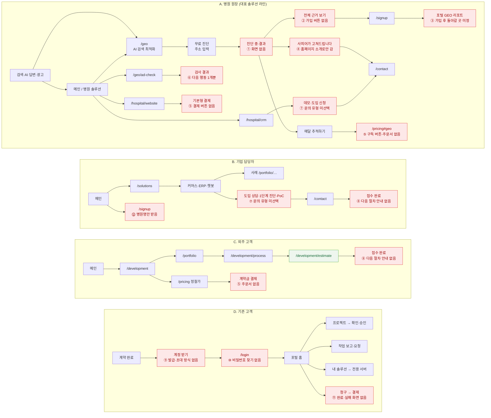

# 방문자별 이동 흐름 (화면 기획 1단계)

2026-11-11 · 현재 와이어프레임의 실제 링크를 따라가며 정리. 빨간 칸은 흐름이 끊기거나 어색한 곳.

## 끊기는 곳과 고칠 방향

| #   | 흐름 | 지금                                                                               | 고칠 방향 (안)                                                                           | 처리 단계                      |
| --- | ---- | ---------------------------------------------------------------------------------- | ---------------------------------------------------------------------------------------- | ------------------------------ |
| ①   | A    | 진단 중·진단 결과 화면이 없다 (회색 상자 하나)                                     | 진단 중 → 결과(총점, 영역별 점수, 우선 개선 3개) 화면 추가                               | 3. 상태 화면                   |
| ②   | A    | 결과에서 "전체 근거 보기 → 가입" 버튼이 없다 (기능 설명에만 있음)                  | 결과 아래 잠긴 근거 목록 + "가입하고 전체 보기"                                          | 반영                           |
| ③   | A    | 가입 후 어디로 가는지 정해지지 않음                                                | 방금 본 진단 결과로 돌아가 전체 공개, 기록은 포털 GEO에 저장                             | 반영 (가입 페이지 S4 표)       |
| ④   | A    | "사피어가 고쳐드립니다"가 홈페이지 소개로만 간다                                   | 문의로 바로 연결, 진단 결과를 문의에 첨부 (유형: 진단 후 개선 상담)                      | 반영                           |
| ⑤   | A·C  | 요금표에 구독·결제 버튼이 없다. 주문서 화면이 없다                                 | 상품마다 버튼 (구독하기 / 결제하기 / 상담) → 주문서 → 토스 결제창 → 완료·실패            | 주문서 반영, 완료·실패는 3단계 |
| ⑥   | A    | 광고 검사 결과 뒤 다음 행동이 "AI 검색 최적화 보기" 하나                           | 가입(검사 기록 저장), 홈페이지 제작 상담 추가                                            | 반영                           |
| ⑦   | A·B  | 모든 신청 버튼이 문의로 가지만 문의 유형이 비어 있다. CRM 데모·도입 신청이 같은 곳 | 버튼마다 문의 유형을 미리 선택 (`/contact?type=...`), CRM 데모와 도입을 다른 유형으로    | 반영 (`routes.contactFor`)     |
| ⑧   | B·C  | 접수 완료 화면에 다음 절차가 없다                                                  | 회신 예상 시간, 다음 절차(상담 → 견적 → 계약 → 포털 계정), 관련 사례 링크                | 반영 (회신 시간은 안)          |
| ⑨   | D    | 계약 고객의 포털 계정을 어떻게 받는지 없다                                         | 사피어가 초대 메일 발송 → 비밀번호 설정, 또는 가입 후 사피어가 고객사에 연결 (결정 필요) | 4. 포털                        |
| ⑩   | D    | 비밀번호 찾기가 없다                                                               | 로그인에 "비밀번호 찾기" → 메일 재설정 화면                                              | 3. 상태 화면                   |
| ⑪   | D    | 결제 완료·실패 화면이 없다                                                         | 완료(영수증 링크), 실패(사유, 다시 결제)                                                 | 3. 상태 화면                   |
| ⑫   | B·C  | 가입 폼이 "병원명"만 받는다. 기업 고객은 가입할 수 없음                            | "병원명 또는 회사명", 고객 유형(병원 / 기업) 선택                                        | 반영                           |

## 결정이 필요한 것

아래 2·3번은 안으로 반영해 두었다. 바꾸려면 `content/pricing.ts`의 `orderablePlanIds`, `features/inquiry/model/content.ts`의 `replyTime`을 고친다.

- ⑨ 계약 고객 계정: 초대 방식과 가입 후 연결 방식 중 무엇으로 할지
- ⑤ 결제 버튼을 둘 상품: GEO 구독, 홈페이지 기본형, 외주 계약금 외에 솔루션 세팅비도 바로 결제할지(상담 후 결제가 자연스러움)
- ⑧ 회신 예상 시간 (예: 영업일 1일 이내)
